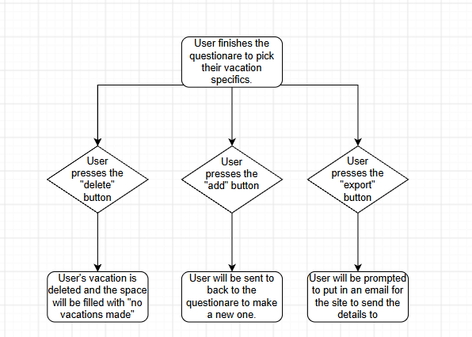

Decision Tree:
Describe a decision process that you will implement on your product website. It must meet the following requirements:
The decision process must have at least three decision nodes.  
Include a description of each decision node and its branches. 
Include why each branch is leading to the final decision that it leads to.

- I want to make a decision tree that starts with the user finishing the questionare, then giving them a final result. When the final result is given, The user can click one of three buttons. one deletes the vacation entirely, one allows the user to create a whole new vacation and brings them back to the start, and one allows the user to send the vacation details to the emial of their choosing.

Flowchart:
Draw a flowchart of your decision tree using the flowchart conventions shown in the examples above. A summary of the flowchart conventions are given in the following:
Rounded rectangles are used for terminal nodes.
Diamonds are used for decision nodes. 
The terminal nodes and decision nodes are connected by labeled arrows for the branches. 

