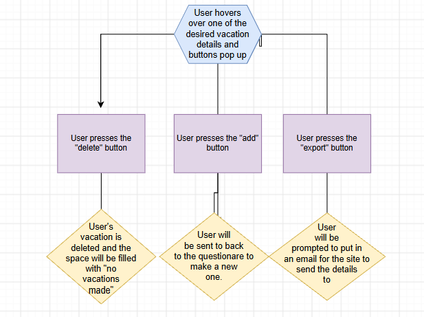

Describe Your Event:

Write a short paragraph that describes an event-handling process you plan to implement on your product website. Your description must include:
The element the user will interact with.
The event that will trigger your response (e.g., click, mouseover, submit, etc.).
The code or behavior that should occur when the event happens.

- I would like to implement the buttons that I had mentioned before into my design now. When you hover over your specified vacation, a few icons will pop up. The trashcan icon will allow you to delete that data, the plus icon will allow you to creat another section, and the rocketship icon will allow you to send the details of your vacation to an email of your choosing

Draw an Event Handling Flowchart
Create a flowchart that visually represents your event-handling process. Use the examples above as a reference. 
Follow these conventions for your diagram:
